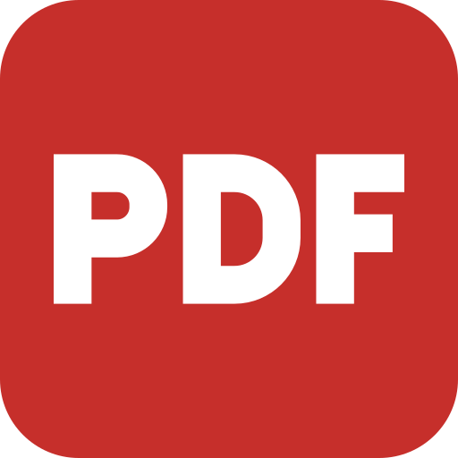

<p align="center">
  
</p>

<h1 align="center">Optimised PDF</h1>

<p align="center">
  <i>Optimised Accounting's offline PDF app for Windows, built on
  <a href="https://github.com/storytold/pdfcraft">PdfCraft</a> v0.21.0.</i><br>
  Not made or endorsed by the ArtCraft team.
</p>

## What it is

Optimised PDF is the PDF tool Optimised Accounting Pty Ltd deploys to staff through Intune. It is
PdfCraft v0.21.0 with these changes:

- named **Optimised PDF**, with a red "PDF" app icon;
- no ArtCraft branding, Discord, website or GitHub links;
- no network access: no update checks or self-updating;
- dark mode by default, a simpler Home screen, and labelled Save, Save As and Print buttons;
- every save writes a clean copy of the file, so deleted or redacted content can't be recovered
  from earlier versions inside it;
- English only.

The full list of changes and their plan is in the project brief (see `ROADMAP.md` history and the
pull requests).

## Building

On Windows with Rust installed:

```
cargo build --release -p pdfcraft
```

The app is `target/release/pdfcraft.exe` until the rename to `OptimisedPDF.exe` lands. Windows
installers are built by the **Build installer** workflow in GitHub Actions.

## Licence

PdfCraft is Copyright (c) 2026 ArtCraft Team and the PdfCraft contributors, under the MIT License
or the Apache License 2.0, at your option (`LICENSE-MIT`, `LICENSE-APACHE`). Optimised
Accounting's changes are under the same licences. Third-party material is listed in `NOTICE` and
`ATTRIBUTION.md`.
