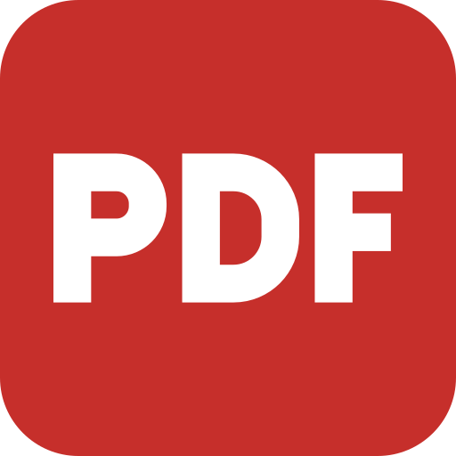

# Optimised PDF app icon



**Design:** the capital letters "PDF" in bold white on a red rounded square, so it is obvious at a
glance what the app is for.

**Lettering:** drawn as stroked geometric paths, not set in a font, so no font is embedded or
licensed. Strokes are 58 units wide with flat (butt) ends and mitred corners; the P and D bowls are
squared-off arcs; every letter runs the full cap height. The gaps between P–D and D–F are equal
(24 units). The lettering is scaled to 392 px wide and centred on the 512 px tile.

**Palette:**

| Colour | Hex | Used for |
|---|---|---|
| Red | `#c62f2b` | the tile (and the PDF document icon's badge and lines) |
| White | `#ffffff` | the lettering |

**Tile:** `viewBox="0 0 512 512"`, a rounded square with `rx=88`. Windows and Linux icons use the
tile as it is. macOS icons put it on Apple's grid (an 824 px body centred on a transparent 1024 px
canvas).

**Provenance:** original artwork by Optimised Accounting Pty Ltd (2026-10-12), `MIT OR Apache-2.0`
like the code: see [LICENSE.txt](LICENSE.txt).

The file names keep the `pdfcraft` prefix and the Linux app id `ai.storyteller.pdfcraft`, which the
build, packaging and existing installs depend on.

## Files

| File | What it is |
|---|---|
| `pdfcraft.svg` | the master vector; every PNG, `.ico` and `.icns` is rendered from it |
| `pdfcraft-small.svg` | the same vector, used in the About dialog and the README |
| `pdfcraft-1024.png` | 1024 px on Apple's grid; also the runtime Dock icon on macOS |
| `pdfcraft.icns` | macOS icon (16–1024 px) |
| `pdfcraft.ico` | Windows icon (16–256 px), embedded in `pdfcraft.exe` by `apps/pdfcraft/build.rs` |
| `pdfcraft-document.svg` | Windows PDF file icon master: a Lucide document outline, red badge and lines, and outlined PDF lettering; no font dependency |
| `pdfcraft-document.ico` | Windows PDF file icon (16–256 px), embedded as resource 2 in `pdfcraft.exe` |
| `hicolor/<n>x<n>/apps/ai.storyteller.pdfcraft.png` | Linux hicolor theme, 16–512 px; the 256 px one is the runtime icon on Windows and Linux |
| `hicolor/scalable/apps/ai.storyteller.pdfcraft.svg` | Linux scalable icon (copy of the master) |

Where it shows: `apps/pdfcraft/src/main.rs` sets the window icon (Dock, taskbar, Alt-Tab, launcher) and the
Wayland app id `ai.storyteller.pdfcraft`; `packaging/linux/ai.storyteller.pdfcraft.desktop` names the
hicolor icon; the About dialog shows `pdfcraft-small.svg`.

Windows PDF files use resource 2 (`"pdfcraft.exe",-2`) when Optimised PDF is chosen as the default
reader; the app keeps resource 1. The document outline is adapted from Lucide `file-text`
1.49.0 (ISC); its badge and outlined lettering are original (`MIT OR Apache-2.0`), covered by
[LICENSE-document.txt](LICENSE-document.txt).

## Regenerate

```sh
packaging/icons.sh        # needs resvg and python3; iconutil (macOS) for the .icns
cargo xtask assets        # then update the sha256 values in ATTRIBUTION.toml and run with --write
```

On Windows: `icons.sh` can't render the macOS 1024 px image (it passes `resvg` a POSIX path) and has
no `iconutil`. Render `pdfcraft.svg` at 824 px, centre it on a transparent 1024 px canvas, and write
the `.icns` from that with Pillow (`Image.save("pdfcraft.icns", sizes=[(16, 16), …, (1024, 1024)])`).
